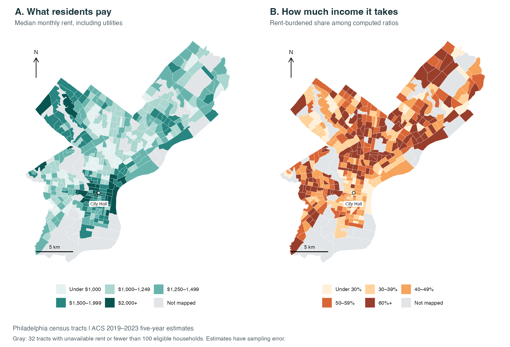
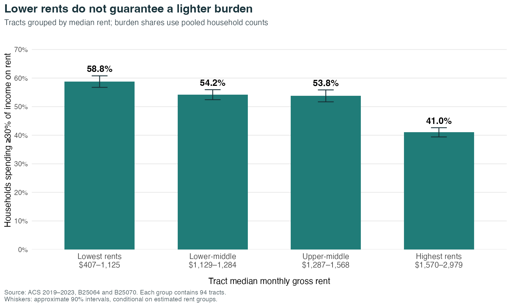

```{r}
#| label: setup
#| include: false
source('code/analysis.R')
pct <- function(x) sprintf('%.1f%%', x)
num <- function(x) format(x, big.mark = ',', scientific = FALSE, trim = TRUE)
```

A lower monthly rent looks like a better deal. But a cheaper apartment can still take a larger share of a household's income. **Where in Philadelphia does lower rent actually mean a lighter burden for the people living there?**

The answer is not a simple map of expensive and inexpensive areas. In the 2019–2023 American Community Survey (ACS), **`r pct(groups$burden_pct[1])` of eligible renter households in the lowest-rent quarter of the tracts studied spent at least 30% of income on rent, compared with `r pct(groups$burden_pct[4])` in the highest-rent quarter.** Lower prices did not necessarily mean less financial pressure.

## Two maps, two different questions

The left map shows each census tract's median monthly **gross rent**, which includes utilities. The right shows the share of renter households spending at least 30% of income on gross rent. I call this rent burden; households whose ratios cannot be computed are excluded from that denominator. Citywide, the estimated share was `r pct(city$burden_pct)`.

{#fig-rent-maps fig-alt="Two maps compare Philadelphia census tracts. The left displays median gross rent; the right displays the share of eligible renter households spending at least 30% of income on rent."}

Around City Hall, many tracts have comparatively high rents but lighter burdens. Several areas to the north and west show the opposite combination: lower rents alongside larger shares of burdened renters. The pattern is uneven, with exceptions in both directions. Census tracts are statistical areas, not exact neighborhood boundaries.

That mismatch is the important geographic finding. A rent map describes the price of housing occupied by current residents. A burden map adds their ability to pay. An expensive area can look less strained because the households living there can afford more, while a lower-priced area can still leave residents stretched. These maps alone do not establish why households or housing prices differ across places.

## Comparing the same city more systematically

To move beyond visually comparing colors, I sorted `r nrow(valid)` tracts into four equal-sized groups by median rent. Within each group, I added the estimated burdened households and divided by all households with computed ratios. This gives households proportional influence rather than treating every tract's percentage equally.

{#fig-rent-groups fig-alt="A bar chart compares pooled rent-burden rates across four groups of Philadelphia tracts, from lowest to highest median rent."}

The lowest-rent group had tract medians of **$`r num(groups$rent_min[1])`–$`r num(groups$rent_max[1])`**, yet its burden rate was about **`r sprintf('%.1f', summary_stats$gap_pp)` percentage points higher** than the highest-rent group's. The direction remains when I require at least 200 or 300 eligible households per tract, and when I exclude tracts with particularly imprecise burden estimates. These checks support the broad comparison, not a ranking of individual blocks.

This does **not** mean a household would save money by moving to a more expensive area. The groups contain different households and housing. Nor does the comparison establish that higher rents cause lower burdens.

## What I would take from this

If I were using a map to identify housing pressure, I would look at rent burden alongside rent levels. Focusing only on the most expensive areas could overlook residents under substantial pressure in cheaper ones. A practical next step would be to examine high-burden areas' housing conditions and eligibility for assistance before targeting resources.

There are limits. ACS five-year estimates pool 2019–2023 responses; they are not today's advertised rents. Individual tract estimates can have wide sampling errors, and household size, subsidies, and housing quality are not controlled here. The analysis includes `r nrow(valid)` of `r nrow(tracts)` tracts, covering about `r pct(summary_stats$included_household_share_pct)` of citywide households with computed ratios.

**For me, the useful distinction is between cheaper housing and housing that residents can afford. A price map answers only the first question.**

## Sources and reproduction

I use Census ACS tables [B25064](https://api.census.gov/data/2023/acs/acs5/groups/B25064.html) and [B25070](https://api.census.gov/data/2023/acs/acs5/groups/B25070.html), downloaded from the official [table-based Summary File](https://www.census.gov/programs-surveys/acs/data/summary-file/2023.html), and [2023 Census cartographic boundaries](https://www.census.gov/geographies/mapping-files/time-series/geo/cartographic-boundary.html). Dollar values are in 2023 dollars.

The [Post 5 README](https://github.com/ruibao1129/6400-rb/blob/main/blog/posts/post5/README.md) links the R scripts, saved source data, calculated tables, and replication instructions. Rendering regenerates the maps, chart, and numerical statements above.
