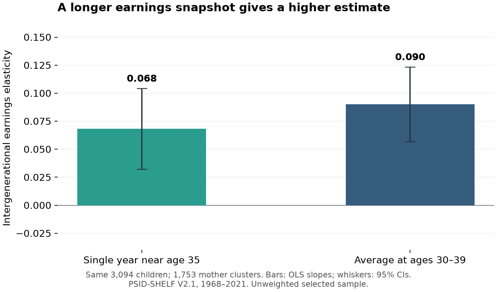
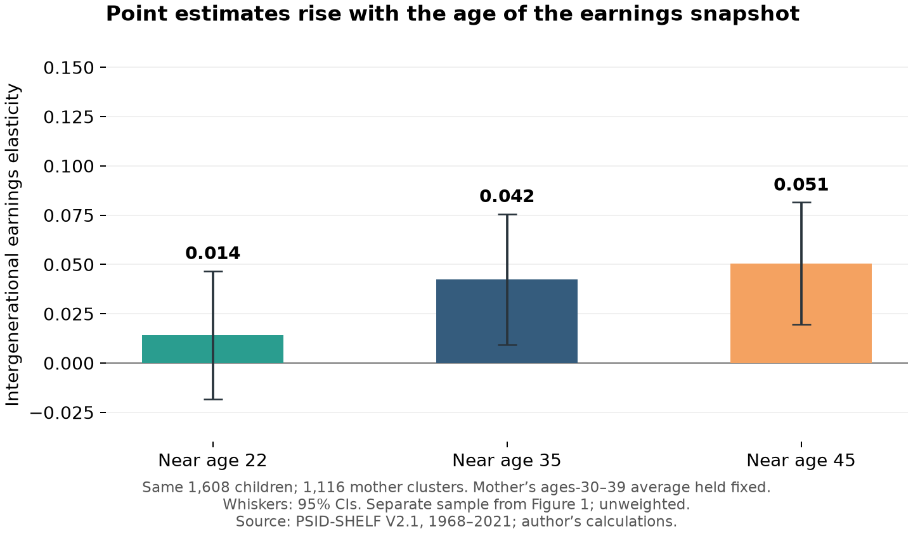
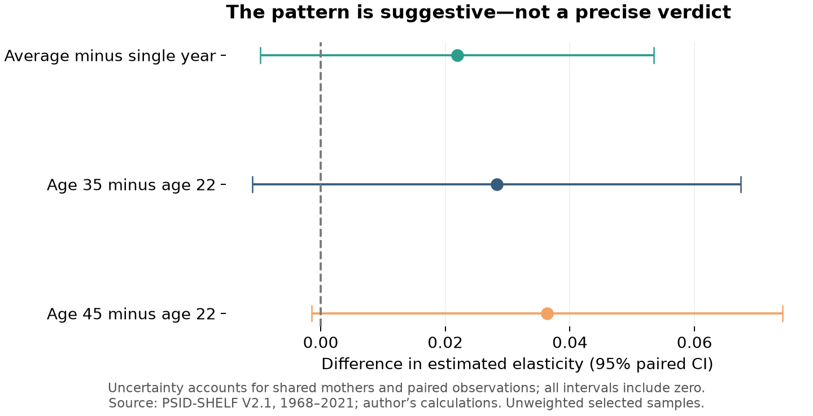

Would you judge a movie from its opening scene? Earnings in your early twenties can be an equally incomplete preview: school, short hours, and job changes may obscure your eventual position. **How strongly do mothers’ earnings predict their children’s, and does the answer change when we measure income later or over more years?**

I use the University of Michigan’s [PSID-SHELF](https://www.icpsr.umich.edu/sites/psid/view/studies/194322), covering 42 survey waves from 1968 through 2021. This is a tutorial in measurement, not a claim that parents determine their children’s destinies.

## 1. Find the family—not just a similar surname

The extract contains 84,121 people, including years without observations. `ID` identifies a person; `REL_PAR_BM_ID` identifies their biological mother. Siblings share a mother, making this a many-to-one match. After the extraction step in the [replication guide](https://github.com/ruibao1129/6400-rb/blob/main/blog/posts/post6/README.md), open the private database:

```python
import sqlite3
import pandas as pd
import numpy as np
con = sqlite3.connect("private/selected_columns.sqlite")
```

SQL’s `GROUP BY` reduces repeated person-year records to one mother link per child. `HAVING` excludes inconsistent links:

```python
con.executescript("""
CREATE TEMP TABLE links AS
SELECT ID, MIN(REL_PAR_BM_ID) AS mother_id
FROM person_year
GROUP BY ID
HAVING COUNT(DISTINCT REL_PAR_BM_ID) = 1
   AND MIN(REL_PAR_BM_ID) > 0;
""")
```

`SELECT` chooses columns; `MIN` retrieves the sole consistent mother ID. An identified mother is not necessarily observed: we still need her earnings records. Run the Python blocks in order from the post folder, in one fresh session, after extracting the data.

## 2. Put both generations on comparable clocks

Income refers to the previous tax year, so measurement age equals survey year minus one minus birth year. I use individual labor earnings in 2024 dollars, not household income. These measures are available for reference persons and spouses; other adult household members are not automatically covered.

I exclude missing, negative, and standardized topcoded amounts, but retain valid zeros in averages. Both generations need at least three observed income years at ages 30–39. `AVG` constructs the measure; `HAVING` enforces coverage:

```python
con.executescript("""
CREATE TEMP TABLE valid AS
SELECT ID, YEAR, YEAR-1-DEMO_BIRTH_YEAR AS age, EARN_TOT_RD AS income
FROM person_year
WHERE REFCOUPLE=1 AND EARN_TOT_ND>=0
  AND EARN_TOT_ND<9999999 AND EARN_TOT_RD>=0;
CREATE TEMP TABLE averages AS
SELECT ID, AVG(income) AS average_income, COUNT(*) AS n_years
FROM valid
WHERE age BETWEEN 30 AND 39
GROUP BY ID
HAVING COUNT(*) >= 3;
CREATE TEMP TABLE singles AS
SELECT ID, income, ROW_NUMBER() OVER
  (PARTITION BY ID ORDER BY ABS(age-35), YEAR) AS rn
FROM valid WHERE age BETWEEN 30 AND 39;
""")
```

For single-year income I select the observation nearest age 35, breaking ties toward the earlier year, **before** requiring positive earnings. I do not search for a more convenient positive paycheck.

`JOIN` connects matching IDs. Joining each income table twice retrieves child and mother measures. Requiring positive single-year and average incomes fixes one common comparison sample:

<details>
<summary>Show the complete comparison-sample join</summary>

```python
matched = pd.read_sql_query("""
SELECT l.ID, l.mother_id, c.average_income AS child_average,
       m.average_income AS mother_average, cs.income AS child_single,
       ms.income AS mother_single
FROM links l
JOIN averages c ON l.ID=c.ID
JOIN averages m ON l.mother_id=m.ID
JOIN singles cs ON l.ID=cs.ID AND cs.rn=1
JOIN singles ms ON l.mother_id=ms.ID AND ms.rn=1
WHERE c.average_income>0 AND m.average_income>0
  AND cs.income>0 AND ms.income>0
ORDER BY l.ID
""", con)
assert matched.ID.is_unique and len(matched) == 3094
```

</details>

## 3. Estimate persistence, then lengthen the snapshot

The intergenerational elasticity is the slope in

$$\log(Y_{child})=\alpha+\beta\log(Y_{mother})+\varepsilon.$$

A slope of 0.09 associates 10% higher maternal earnings with approximately 0.9% higher child earnings—not a 9% inherited share or a causal effect. The calculation is:

```python
def slope(parent, child):
    X = np.column_stack([np.ones(len(parent)), np.log(parent)])
    return np.linalg.lstsq(X, np.log(child), rcond=None)[0][1]

single = slope(matched.mother_single, matched.child_single)
average = slope(matched.mother_average, matched.child_average)
print(f"Single: {single:.3f}; average: {average:.3f}")
```

The full script also clusters uncertainty by mother because siblings are not independent.



Among the same 3,094 children and 1,753 mothers, the estimate rises from **0.068** for single-year earnings to **0.090** for multiyear averages. Mothers contribute 8.35 years on average; children contribute 5.39. Averaging can dampen temporary fluctuations, although it does not guarantee a lifetime-income measure.

## 4. Replay the same children at different ages

Next I hold maternal average earnings fixed and compare child earnings nearest ages 22, 35, and 45, within windows 20–24, 30–39, and 40–49. All three estimates use exactly the same 1,608 children and 1,116 mothers. This is a **separate sample** from Figure 1, not a directly comparable fourth bar.



The point estimate increases from **0.014** near 22 to **0.042** near 35 and **0.051** near 45. Figure 1 changes the length of the snapshot; Figure 2 changes its timing. Figure 3 asks whether either apparent change is precisely estimated.



However, every paired 95% confidence interval includes zero. The age-45-minus-age-22 difference is 0.036, with an interval of −0.001 to 0.074. These results suggest a pattern; they do not establish bias relative to an unobserved true lifetime elasticity.

The mechanism is distinct from temporary noise: if early log earnings respond only half as strongly to lifetime status as mature earnings do, and the remaining error is unrelated to maternal status, a lifetime slope of 0.4 would appear as 0.2 early on. This is an illustrative assumption, not a PSID estimate. Averaging reduces transitory noise; averaging only early ages need not remove lifecycle bias.

## 5. The takeaway: match people precisely, measure status patiently

Can one paycheck tell the family's economic story? Not reliably on its own. Figure 1 shows higher persistence with averaging; Figure 2 shows higher point estimates at later ages; Figure 3 shows why neither pattern warrants a definitive claim. A precise family join cannot rescue an incomplete measure of economic status.

These are unweighted, selected-sample associations. Long follow-up requirements, attrition, positive-income restrictions, and reference-couple coverage limit generalization. The earnings construction also excludes farming income after 1993, creating a comparability limitation. Neither averaging nor a larger sample eliminates these issues. The safest conclusion is that **when we measure income deserves as much attention as whose income we match**.

## Code and data access

The [replication guide](https://github.com/ruibao1129/6400-rb/blob/main/blog/posts/post6/README.md) and [complete analysis](https://github.com/ruibao1129/6400-rb/blob/main/blog/posts/post6/code/analysis.py) include the age comparison, clustered uncertainty, and fixed specification. Raw PSID microdata remain private and must be obtained from the provider; they are not redistributed here.
