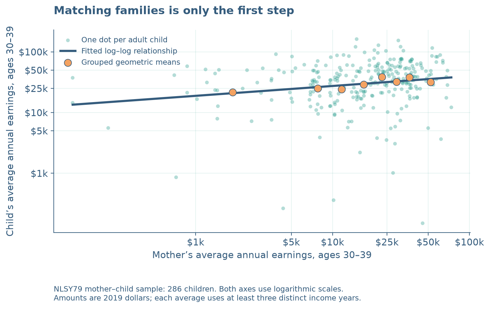
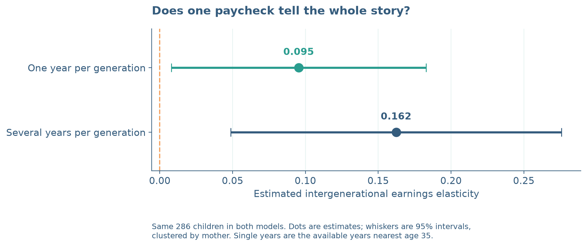

Would you judge a whole movie from its opening scene? An income recorded while someone is studying, changing jobs, or raising a child can be an equally misleading preview. **How well do a mother’s earnings predict her child’s—and how much does the answer depend on which paycheck we measure?**

This tutorial uses SQL inside Python to link real families, construct comparable earnings measures, and estimate intergenerational elasticity (IGE). The surprise is that finding the right family is easier than finding the right measure of economic status.

Your first paycheck is not your lifetime income. Here I compare annual earnings near specified ages, rather than anyone's literal first payment from a job.

## 1. Give every person the right key

I use the [NLSY79 and its Child/Young Adult survey](https://www.nlsinfo.org/investigator/). The extracts contain 11,551 children and 4,943 corresponding mothers. A child’s `C0000100` identifies the child; `C0000200` identifies the mother and matches `R0000100` in her file, as the [NLS linkage documentation](https://nlsinfo.org/content/cohorts/nlsy79-children/other-documentation/codebook-supplement/appendix-h-identification) explains. Siblings share a mother ID, so the relationship is many-to-one.

Work from `blog/posts/post6/`. The snippets explain key steps, not a standalone script. After obtaining the extracts, run `python code/analysis.py` for the complete workflow and saved SQLite database; the [README](https://github.com/ruibao1129/6400-rb/blob/main/blog/posts/post6/README.md) explains installation and data access.

First, read the two CSV files:

```python
import sqlite3
import pandas as pd
children = pd.read_csv("data/raw/children.csv")
mothers = pd.read_csv("data/raw/mothers.csv")
```

Next, give the identifiers readable names, check unique keys, and load the tables into SQLite, Python's built-in SQL database. Expand the preparation below to run this demonstration through the join in Step 2.

<details>
<summary>Show data preparation: rename, check, and load into SQLite</summary>

Run this once after reading the CSVs:

```python
children = children.rename(columns={
    "C0000100": "child_id", "C0000200": "mother_id",
    "C0005700": "birth_year", "C0005400": "sex"
})
mothers = mothers.rename(columns={
    "R0000100": "mother_id", "R0000500": "birth_year"
})
mothers["birth_year"] += 1900  # Original years are 57–64.
assert children.child_id.is_unique
assert mothers.mother_id.is_unique

con = sqlite3.connect(":memory:")
children.to_sql("children", con, index=False)
mothers.to_sql("mothers", con, index=False)
```

</details>

## 2. Match families, then check the join

`SELECT` chooses columns. `JOIN` connects rows whose mother IDs agree:

```python
con.executescript("""
CREATE TABLE matches AS
SELECT c.child_id, c.mother_id, c.birth_year,
       c.sex, m.birth_year AS mother_birth_year
FROM children AS c
JOIN mothers AS m ON c.mother_id = m.mother_id;
""")
assert con.execute("SELECT COUNT(*) FROM matches").fetchone()[0] == len(children)
```

All children match. Checking unique keys first matters: duplicate mother rows could quietly multiply observations. We also aggregate each person’s income history **before** joining generations, preventing one mother-year from pairing with every child-year.

## 3. Turn paychecks into comparable income

Here, “income” means annual wage and salary earnings, not household income. The full script reshapes the histories, treats negative survey codes as missing, retains valid zeros, and converts earnings to 2019 dollars using [BLS CPI-U through FRED](https://fred.stlouisfed.org/series/CPIAUCNS). Income-band answers are excluded because their category numbers are not dollars. For the 2014–2020 child waves, the reference year is actual interview year minus one; earlier waves follow their codebooks. Age is measured at income-year end.

Both generations’ averages use available observations within ages 30–39, requiring at least three income years. `GROUP BY` collects each child’s rows; `AVG` and `COUNT` perform aggregation:

```sql
SELECT child_id, AVG(real_income) AS child_avg,
       COUNT(DISTINCT income_year) AS child_years
FROM child_income
WHERE age BETWEEN 30 AND 39
GROUP BY child_id
HAVING COUNT(DISTINCT income_year) >= 3;
```

Apply the same operation to mothers, then join the two person-level summaries through `matches`. The full script also selects each person's available year nearest age 35 within ages 30–39, breaking ties toward the earlier year, and creates `matched` after requiring positive selected incomes and averages. This leaves **286 children from 245 mothers**, identical across both models. Zeros enter averages but cannot be logged as single-year earnings; these selection requirements explain why far fewer children enter the regressions than the initial match.

{#fig-family fig-alt="Logarithmic scatterplot of mothers' and children's average annual earnings, with grouped geometric means and a fitted line."}

## 4. Estimate the elasticity, not economic destiny

Estimate

$$
\log(Y_{child})=\alpha+\beta\log(Y_{mother})+\varepsilon.
$$

The slope $\beta$ is the IGE: roughly, the percentage difference in children's earnings associated with 1% higher maternal earnings. Open the database generated by the complete script—not the temporary in-memory demonstration above—to fit the regression:

```python
import numpy as np

con = sqlite3.connect("results/private/analysis.sqlite")
matched = pd.read_sql_query("SELECT * FROM matched", con)
X = np.column_stack([np.ones(len(matched)), np.log(matched.mother_avg)])
alpha, beta = np.linalg.lstsq(X, np.log(matched.child_avg), rcond=None)[0]
```

The single-year estimate is **0.095**, versus **0.162** using averages. The latter associates 10% higher maternal earnings with about **1.6% higher child earnings**. Averages contain 6.8 maternal and 3.1 child income years on average.

{#fig-comparison fig-alt="Two IGE estimates compare one income year per generation with multiyear income averages, including 95 percent confidence intervals."}

The difference is 0.067, with a mother-clustered 95% interval of [-0.022, 0.156]. The interval includes zero: the data do not establish that the two slopes differ. Nor do we observe lifetime income to determine which estimate is closer to the truth. Averaging can reduce temporary noise; it does not guarantee a larger or unbiased estimate.

## 5. Change the camera angle: life-cycle bias

For 221 of these children, positive income is also observed near age 22 within ages 20–24. Holding their sample and mothers’ average income fixed gives an early-career slope of 0.161 and a thirties slope of 0.163. These uncertain estimates cannot reveal the true lifetime IGE.

The mechanism is clearer in a hypothetical example. Assume true lifetime IGE is 0.40, maternal lifetime earnings are measured without error, and early child log earnings load only halfway on lifetime log earnings, with remaining noise unrelated to maternal income. The early slope is $0.5\times0.40=0.20$; full loading at midcareer gives 0.40. This illustrates **life-cycle bias** under explicit assumptions, not a bias established by the NLS estimates: future high earners may still be training when measured young.

{#fig-lifecycle fig-alt="Two panels distinguish uncertain observed age-specific slopes from a hypothetical example showing early-career slopes of 0.20 and a midcareer slope of 0.40."}

Averaging several years dampens short-lived shocks. Averaging only young years can retain the same age distortion, which is why the main comparison aligns both generations in their thirties. [Haider and Solon (2006)](https://doi.org/10.1257/aer.96.4.1308) document the broader age-dependent measurement problem.

These are unweighted associations in a selected sample with observed earnings. Attrition, excluded zeros, topcoding, and mothers’ labor-force participation limit generalization. Neither estimate is causal or a national mobility statistic.

## Code and reproducibility

The [GitHub project folder](https://github.com/ruibao1129/6400-rb/tree/main/blog/posts/post6) contains the tutorial source, Python/SQL code, figures, result tables, and README with data-extraction and replication instructions. Run `python code/analysis.py` to regenerate the analysis and article, then `quarto render index.qmd` to build the webpage. Detailed variable definitions follow the [NLS income guide](https://www.nlsinfo.org/content/cohorts/nlsy79-children/topical-guide/income/introduction) and downloaded codebooks.

**Takeaway:** Figure 1 shows the matched-family association; Figure 2 shows how the estimate changes with income measurement, without establishing a difference; Figure 3 separates an inconclusive age comparison from a transparent bias illustration. Match the family, align the life stage, and average income—but do not confuse a better measurement strategy with proof of lifetime mobility.
