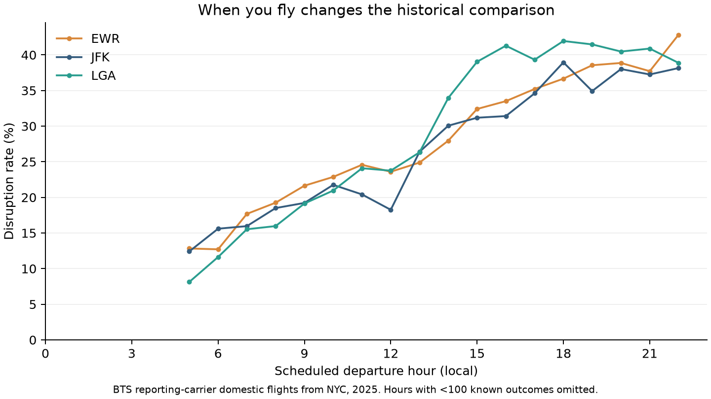

The 6 a.m. flight costs you sleep. A later one may cost you time at the airport. **Which scheduled departure hours had fewer disruptions in the records—and does the answer change with the airport, airline, or month?**

I examine **360,771 domestic flight records** scheduled to leave JFK, LaGuardia (LGA), or Newark (EWR) during 2025, from the [Bureau of Transportation Statistics](https://www.transtats.bts.gov/TableInfo.asp?QO_fu146_anzr=b0-gvzr&gnoyr_VQ=FGJ). A full calendar year avoids treating one season as typical. These are reporting-carrier records, not all international flights or a forecast for your next trip. The economic trade-off is practical: departure time is one choice travelers can compare when reliability matters alongside fare and convenience.

## 1. Read the clock you can actually book

I group flights by **scheduled**, not actual, local departure hour. A delayed morning flight should not become an afternoon observation. Following BTS, an arrival at least 15 minutes late counts as delayed. Cancellations and diversions are retained as distinct outcomes, not discarded as missing arrival times.

The default **disruption rate** combines arrival delay, cancellation, and diversion, divided by records with a classified outcome. Arrival-delay rates alone use reported, non-cancelled, non-diverted arrivals; cancellation rates use all scheduled records. One record has an unclassified outcome; it is excluded from the disruption and arrival-delay denominators. These measures answer different questions.

For all three airports together, the 06:00–08:59 window had a **15.6%** disruption rate, versus **39.0%** at 18:00–20:59: a difference of **23.4 percentage points**. Those windows were chosen before inspecting the results, not selected as the best and worst hours.

```{=html}
<style>
.b7-widget{margin:1.5rem 0 2rem;border-top:3px solid #2A9D8F;padding-top:1rem;min-width:0}
.b7-controls{display:grid;grid-template-columns:repeat(2,minmax(0,1fr));gap:.8rem;background:#f4f8f8;padding:1rem;border-radius:8px}
.b7-controls label{font-size:.9rem;font-weight:600;display:block}.b7-controls select{display:block;width:100%;max-width:100%;padding:.45rem;margin-top:.25rem;color:#243746;background:white;border:1px solid #b5c7cd;border-radius:4px;font-size:.9rem}
.b7-context{font-weight:600;margin:.8rem 0 .3rem}.b7-note{font-size:.86rem;color:#4b5d66;line-height:1.5}
.b7-chart{width:100%;min-width:0}.b7-widget button{padding:.35rem .8rem;border:1px solid #355C7D;background:white;color:#243746;border-radius:4px}
#b7-hour{height:350px}#b7-heat{height:410px}#b7-outcomes{height:420px}
.b7-widget h3{font-size:1.35rem;margin-top:1.4rem}.b7-widget h2{font-size:1.65rem;margin-top:1.8rem}.b7-widget .b7-subheading{margin-top:1rem}
@media(max-width:540px){.b7-controls{grid-template-columns:1fr}.b7-note{font-size:.82rem}#b7-outcomes{height:520px}}
</style>
<div class="b7-widget">
<p><strong>Explore the record, not just the average.</strong> Start with all airports, then select an airport, reporting airline, and month. Switch the outcome to distinguish arrival delay from cancellation. Hover or tap for counts; click a calendar cell to select its month. Use Reset to return to the full year.</p>
<div class="b7-controls">
<label for="b7-airport">Departure airport<select id="b7-airport"><option value="ALL">All three airports</option><option value="EWR">EWR — Newark</option><option value="JFK">JFK — John F. Kennedy</option><option value="LGA">LGA — LaGuardia</option></select></label>
<label for="b7-carrier">Reporting / operating airline<select id="b7-carrier"><option value="ALL">All reporting airlines</option></select></label>
<label for="b7-month">Month (hourly view and outcome breakdown)<select id="b7-month"><option value="ALL">Full year</option></select></label>
<label for="b7-metric">Outcome (hourly view and calendar)<select id="b7-metric"><option value="disruption">Delayed arrival, cancellation or diversion</option><option value="arrival">Arrival delay of 15+ minutes</option><option value="cancel">Cancellation</option><option value="departure">Departure delay of 15+ minutes</option></select></label>
<div><button id="b7-reset" type="button">Reset all filters</button></div>
</div>
<p id="b7-context" class="b7-context"></p>
<p id="b7-summary" class="b7-note" aria-live="polite"></p>
<p id="b7-definition" class="b7-note"></p>
<h3 class="b7-subheading">View 1. How does the hourly rate change?</h3>
<div id="b7-hour" class="b7-chart" role="img" aria-label="Interactive historical outcome rate by scheduled departure hour"></div>
<p class="b7-note">Source: BTS Reporting Carrier On-Time Performance, 2025; author’s calculations. Flight-weighted rates, not averages of airline percentages. Blank hours have fewer than 100 eligible records.</p>
<h2>2. Is the annual pattern also the monthly pattern?</h2>
<p>The calendar uses the same selected outcome and airport/airline filters, but always shows all 12 months. For the pooled full-year selection, July had the highest monthly disruption rate (37.3%), while September had the lowest (18.6%). These are whole-month rates, not the individual heatmap-cell rates. Darker cells indicate higher rates, not more flights. The fixed 0–100% color scale allows comparisons across selections.</p>
<p id="b7-heat-context" class="b7-note"></p>
<div id="b7-heat" class="b7-chart" role="img" aria-label="Interactive month by scheduled departure hour heatmap"></div>
<p class="b7-note">Source: BTS, 2025; author’s calculations. Grey or blank cells are unavailable or below the 100-eligible-record threshold, never assumed to have zero delays.</p>
<h2>3. Does the flight arrive late—or not arrive as planned?</h2>
<p>A delay rate among completed flights leaves cancellations out. Across the full dataset, 2.6% of records were cancelled and 0.3% were diverted. The stacked view restores those outcomes to the denominator: all scheduled records in each hour band, for the chosen airport, airline, and month.</p>
<div id="b7-outcomes" class="b7-chart" role="img" aria-label="Interactive stacked shares of on-time arrival, delayed arrival, cancellation, diversion, and unclassified outcomes"></div>
<p class="b7-note">Source: BTS, 2025; author’s calculations. Arrival &lt;15 minutes late includes early arrivals. All five categories sum to 100%; hour bands with fewer than 100 scheduled records are blank. Changing the outcome selector does not change this five-category breakdown.</p>
<span id="b7-status" class="b7-note" role="status"></span>
<noscript><p>JavaScript is required for the interactive charts. The downloadable counts and static preview are available in the repository.</p></noscript>
</div>
<script src="assets/plotly.min.js"></script>
<script src="assets/explorer-data.js"></script>
<script src="assets/explorer.js"></script>

```

## 4. Check that the story is not just different routes

The interactive views hold your selected airport and reporting airline fixed, but their routes can still differ across hours. As a separate check, I compare morning and evening within the **same origin, destination, reporting airline, and month**, requiring at least 30 classified outcomes in each window. Both windows receive identical pooled-cell weights.

The check retains **620 comparable groups** covering **58,974 classified outcomes**:

| Comparison | 06:00–08:59 | 18:00–20:59 |
|---|---:|---:|
| Pooled disruption rate | 15.6% | 39.0% |
| Common-group standardized rate | 14.9% | 39.2% |

The common-group check preserves the direction of the pooled morning advantage, although its magnitude changes. Its retained records represent only **16.3% of all classified outcomes** in the annual dataset; routes without enough records in both windows are excluded, so this check cannot represent every route. It is not a randomized comparison: flight schedules, passenger choices, weather, and other conditions are not held constant. The data do not identify why the pattern occurs.

## Takeaway: check the pattern behind the average

In these 2025 records, the morning comparison window had fewer recorded disruptions than the evening window. The hourly view shows the overall timing pattern; the calendar reveals how it varies by month; the outcome breakdown shows whether delay, cancellation, or diversion accounts for the recorded disruption share. No single pooled percentage supplies all three answers.

For a traveler, the useful step is to **compare the available time windows for the relevant airport, airline, and season**, rather than rely on a universal “best departure time.” These historical flight-level rates are not passenger-weighted probabilities or a causal benefit from changing your ticket. They exclude fares and missed-connection costs, so this is not a calculation of the cheapest or most valuable flight.

These are descriptive rates without confidence intervals or significance tests. The 100-record plotting threshold limits sparse displays; it does not establish statistical significance or justify precise rankings of neighboring hours. The results do not quantify uncertainty about future flights.

## Data and reproducibility

The [replication guide](https://github.com/ruibao1129/6400-rb/blob/main/blog/posts/post7/README.md) identifies the cached NYC subset, original monthly downloads, definitions, and commands. Python computes additive counts; Plotly renders the interactive views locally without a server or CDN. Sparse hourly groups are hidden rather than presented as precise rankings. See [BTS definitions](https://www.transtats.bts.gov/TableInfo.asp?QO_fu146_anzr=b0-gvzr&gnoyr_VQ=FGJ) and [the complete analysis](https://github.com/ruibao1129/6400-rb/blob/main/blog/posts/post7/code/analyze.py).
