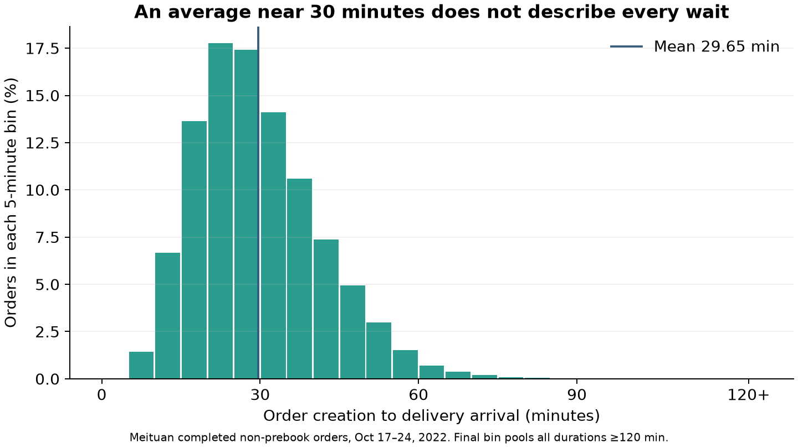
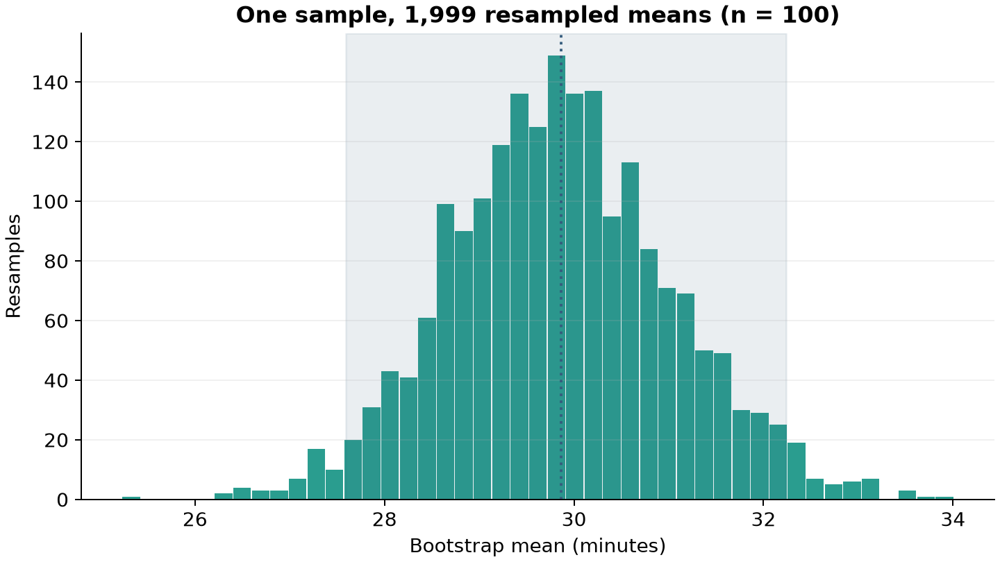
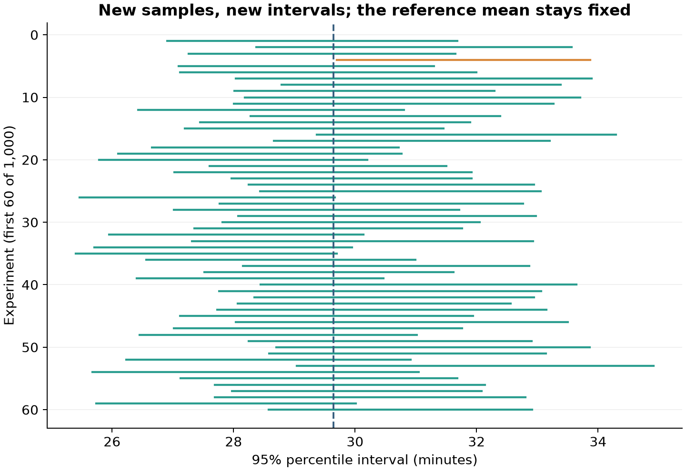
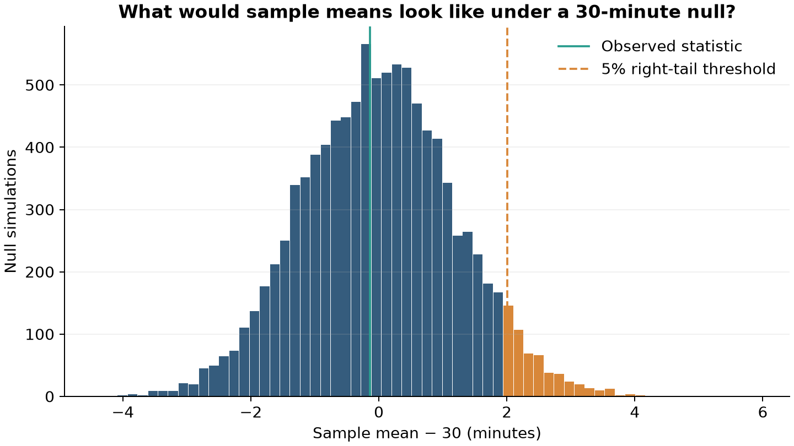

Dinner took forever. Your last few orders felt slow, too. **How much can a handful of deliveries tell you about average waiting time?** The answer requires separating individual experiences, uncertainty about a mean, and evidence against a benchmark.

## 1. Real orders, uneven waits

Meituan is a Chinese food-delivery platform, comparable to DoorDash or Uber Eats. I use its [official INFORMS TSL research dataset](https://github.com/meituan/Meituan-INFORMS-TSL-Research-Challenge), retaining **546,364 completed, non-prebook orders dated October 17–24, 2022**. Waiting time is delivery arrival minus order creation, in minutes—not just the courier’s travel time. Rejected assignment attempts are not separate completed orders; zero timestamps mean unavailable.

The retained reference set averages **29.65 minutes**, with a median of **27.90**. Yet **10.9%** exceed 45 minutes. An average near half an hour can coexist with many frustrating waits.

I retain 81 waits over 120 minutes, including a maximum of 645.42 minutes. These extreme timestamps cannot be independently validated. Excluding waits over 120 minutes changes the mean to 29.62 minutes, a small change; the main analysis keeps them.



For the experiments, treat these recorded durations as a fixed **empirical population**, drawing independently with replacement. We pretend the analyst sees only a small sample; the full reference set supplies the known mean for checking coverage, not for constructing that sample’s interval or test. The observations are real; the repeated samples are simulated.

## 2. One sample, many possible averages

The default example uses a fixed-seed sample of 100 orders and a 95% confidence level. Its mean is **29.86 minutes**. Resample those same 100 observations with replacement 1,999 times, always keeping sample size 100, and calculate each resample’s mean. These are not new orders: the bootstrap approximates sampling uncertainty using the observed sample.

The middle 95% of bootstrap means gives a **percentile interval of 27.59–32.24 minutes**. Switch the controls to compare settings: chart summaries update, while prose examples retain their stated settings.

```{=html}
<style>
.b8-controls{display:grid;grid-template-columns:repeat(2,minmax(0,1fr));gap:1rem;padding:1rem;background:#f2f7f7;border-top:3px solid #2A9D8F;border-radius:5px}
.b8-controls label{font-weight:600;font-size:.95rem}.b8-controls select{display:block;width:100%;padding:.5rem;margin-top:.4rem;border:1px solid #b5c7cd;background:white;color:#243746;border-radius:4px}
.b8-controls button{padding:.4rem .8rem;background:white;border:1px solid #355C7D;border-radius:4px;color:#243746}
.b8-note{font-size:.88rem;color:#485c66;line-height:1.5}.b8-summary{border-left:3px solid #2A9D8F;padding-left:.8rem;margin-top:1rem}
.b8-chart{width:100%;min-width:0}#b8-bootstrap{height:370px}#b8-coverage{height:510px}#b8-null{height:380px}
.b8-sr-only{position:absolute!important;width:1px;height:1px;padding:0;margin:-1px;overflow:hidden;clip:rect(0,0,0,0);white-space:nowrap;border:0}
@media(max-width:540px){.b8-controls{grid-template-columns:1fr}.b8-note{font-size:.82rem}}
</style>
<div class="b8-controls">
<label for="b8-n">Sample size (all three interactive views)<select id="b8-n"><option value="20">20 deliveries</option><option value="100" selected>100 deliveries</option><option value="400">400 deliveries</option></select></label>
<label for="b8-level">Two-sided interval confidence (first two views)<select id="b8-level"><option value="90">90%</option><option value="95" selected>95%</option><option value="99">99%</option></select></label>
<div><button id="b8-reset" type="button">Reset to n = 100, 95%</button></div>
</div>
<p class="b8-note">Change sample size to compare nested, fixed-seed samples. Change confidence to see the width–coverage trade-off. These are precomputed, reproducible experiments, not fresh simulations each time you click. Hover or tap for details.</p>
<p id="b8-bootstrap-summary" class="b8-summary" aria-live="polite"></p>
<div id="b8-bootstrap" class="b8-chart" role="img" aria-label="Bootstrap distribution of sample means and a percentile confidence interval"></div>
<p class="b8-note">Figure 2. Green bars: resampled means; green boundaries and shading: selected interval; dotted blue line: original sample mean. Source: author’s resampling of real Meituan deliveries.</p>

<h2>3. Does “95%” actually work 95% of the time?</h2>
<p>Now draw 1,000 new samples from the full reference distribution. For each, restart the bootstrap and construct a new interval. Because we know the reference mean, we can count successes. At n = 100, the 95% procedure covers it in <strong>95.5%</strong> of experiments; at n = 20 and 400, coverage is 92.8% and 95.0%. Small samples need not achieve the label’s promise.</p>
<p id="b8-coverage-summary" class="b8-summary" aria-live="polite"></p>
<div id="b8-coverage" class="b8-chart" role="img" aria-label="Repeated-sample bootstrap confidence intervals covering or missing the known empirical reference mean"></div>
<p class="b8-note">Figure 3. Green intervals cover the fixed reference mean; orange ones miss. Dashed blue line: reference mean. More Monte Carlo repetitions stabilize the estimated coverage; they do not repair a poorly calibrated interval. The first 60 experiments are displayed without selection.</p>
<p>The 95% describes repeated use of the procedure, not a 95% probability assigned to the fixed mean after seeing one interval. Nor is it a range containing 95% of individual delivery times. A narrower interval from a larger sample does not make your next dinner arrive more predictably.</p>

<h2>4. Is there evidence that the mean exceeds 30 minutes?</h2>
<p>Use a one-sided test: H₀: μ = 30 versus H₁: μ &gt; 30. Thirty minutes is an illustrative benchmark, not a platform guarantee. Subtract the sample mean from each sampled duration and add 30, imposing the null before resampling. Generate 9,999 null samples and calculate T = sample mean − 30. This sample-centered bootstrap test approximates the null distribution; it is not an exact test for every possible delivery-time distribution.</p>
<p id="b8-null-summary" class="b8-summary" aria-live="polite"></p>
<div id="b8-null" class="b8-chart" role="img" aria-label="Simulated null distribution, observed statistic and a one-sided five-percent rejection region"></div>
<p class="b8-note">Figure 4. Green line: observed statistic. Dashed orange line: approximate 95th percentile of the null distribution; the right tail is the 5% rejection region. Bin coloring approximates that boundary; p is calculated from individual simulated statistics, not histogram bars. Source: sample-centered empirical-null simulation. The test stays at α = 0.05 when interval confidence changes.</p>
<p>The p-value counts null statistics at least as large as observed, using (extreme count + 1)/(9,999 + 1). For the default 100-order sample, p = <strong>0.5452</strong>, so do not reject the 30-minute null. This is not the probability that H₀ is true, and failing to reject does not prove equality. The one-sided test and two-sided interval are different procedures.</p>
<span id="b8-status" class="b8-sr-only" role="status" aria-live="polite" aria-atomic="true"></span>
<noscript><p>Enable JavaScript for interactive views. Static versions appear below.</p></noscript>
<script src="assets/plotly.min.js"></script>
<script src="assets/explorer-data.js"></script>
<script src="assets/explorer.js"></script>

```

## Takeaway: a slow dinner is not a statistical verdict

**More representative observations—not more resamples of the same few orders—provide more information about the service.** The first figure shows why individual waits vary. The bootstrap quantifies uncertainty from one sample; repeated sampling checks its coverage; the null simulation asks whether an observed mean is unusually high under a stated benchmark.

As an illustration, the default 100-order sample gives a 95% interval of **27.59–32.24 minutes**, and the one-sided test provides insufficient evidence that the mean exceeds 30 minutes. This is an example of interpreting uncertainty, not a verdict on the platform.

Real orders can share couriers, merchants and demand conditions. The independent-draw experiment deliberately removes that dependence; its coverage is not a guarantee for convenience samples or correlated customer histories. The data describe this historical release, not all customers. Without a comparison across periods, they cannot establish whether service has become slower or why.

## Sources and reproducibility

This research was supported by data provided by Meituan. To respect the publisher’s redistribution restrictions, raw order records are not included in this repository. The [replication guide](https://github.com/ruibao1129/6400-rb/blob/main/blog/posts/post8/README.md) provides the official download link and code to obtain the exact data version used, plus cleaning rules, seeds and saved outputs. Methods: [percentile bootstrap documentation](https://docs.scipy.org/doc/scipy/reference/generated/scipy.stats.bootstrap.html) and [Hesterberg’s discussion of bootstrap accuracy](https://pmc.ncbi.nlm.nih.gov/articles/PMC4784504/).
